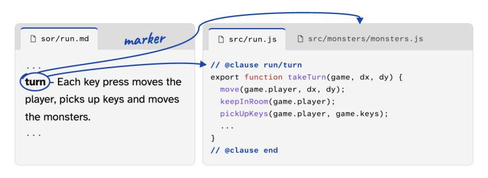

# Spec of Record (SoR)

A development philosophy and toolchain for AI-built software. Plain-language specs are the source code, and an AI agent
acts like a compiler. The spec is split into parts with responsibilities, so engineering, QA and UX can each focus on
their own area of expertise while the whole team works from one source. You can jump from any part of the spec to its
code, and back. The AI changes the spec first, then the code. If you change the code yourself, it updates the spec to
match.

Version 0.1, a draft proposal by [Sebastian Rath](https://sebastianrath.io). The page that explains it is
[index.html](index.html). This repository holds the format, the tools and two projects built with them.

## The goal

AI writes code fast, and keeps rewriting it. The reason a code line exists lives in tickets and commit history, not in the
code itself. That makes AI-written code hard to understand and future changes hard to justify with confidence, for people
and for the AI that has to work on it. Reviews grow, and developers end up supervising output instead of building new
ideas. Spec of Record aims to bring back what that constant rewriting takes away:

- **Structure.** One set of spec files describes the whole project, split into parts and clauses.
- **Maintainability.** A change is one clause and the code behind it, not a search through generated files.
- **Reviewability.** A reviewer reads what changed in the spec and sees exactly which code it touched.
- **Auditability.** Every line of code says which clauses it came from, and every finished build keeps its test results.
- **Developer satisfaction.** You decide what the software does, in a spec you can read, and you stay its author.

## What is Spec of Record?

Think of the specs as your new `src/` folder. They have a familiar structure, but they are written in plain language
instead of code. You change the specs. The AI changes the code to match (and vice versa). They live in a `sor/` folder
next to your code, as plain Markdown files that you commit with it. Spec of Record needs no service or account of its own.

The specs are made of **clauses**. A clause is a rule, a number or a table row. Below is one clause and the code built
from it.



The marker is a comment that names the clause, so spec and code point at each other. The link works both ways and for
everyone. A person can trace it in the editor, from a clause to its code and from a line of code back to its clause. An AI
or a script can trace it with a command that returns the same answer as text or JSON.

You keep your language, framework, editor, tools and coding agent. Change one sentence in the spec, say the player moves
only every second key press, and the associated code blocks are updated. If you change the code yourself, the AI updates
the spec to match.

The spec is the source code. The AI acts like a compiler.

| Legacy development | Spec of Record |
|---|---|
| You write source code | You write the spec |
| A compiler turns it into a program | The AI turns it into code |
| Only changed files are rebuilt | Only the affected code is rebuilt |
| Tests check the program | Each clause can have its own test |

One difference. An AI does not write the same code twice. So finished code is kept, never regenerated from scratch, and
every clause should have a test.

## The problem it solves

Spec drift is when the spec says one thing, the code does another, and nobody can tell which is right. It builds up one
change at a time. Take a game. The spec says the player must collect 3 keys to open the exit, and the game designer wants
5. The AI changes the code to 5, but the spec stays at 3, because nobody asked for an update or the AI forgot. Now the spec
says 3 and the code says 5. A new teammate reads the spec and believes it.

Spec of Record keeps one set of spec files that describe your project and always match the code. The tools keep it that
way.

## Try it

Install the plugin in Claude Code:

```text
/plugin marketplace add sebastianrath/specofrecord
/plugin install specofrecord@specofrecord
```

Then, for a **new project**, in an empty folder, tell Claude Code what to build. For example:

> I want to build a game engine. Write the first specs following Spec of Record.

For an **existing project**, name the one thing you are about to change. Only that goes under a spec. For example:

> I am about to change the checkout. Put just that under Spec of Record first, then make my change.

Today the workflow comes as a Claude Code plugin. Requirements and other ways to load it are in the
[plugin README](plugins/specofrecord/README.md). Any language, framework or editor works, and a person can write the code
too.

## The tools

You can follow the philosophy by hand. The tools check it for you.

- **Change list.** Shows what changed since the last build, and what to rebuild.
- **Edit guard.** Stops the AI from changing code before its clause. A change you make yourself is flagged, and the AI
  updates the spec to match.
- **Test runner.** Runs each clause's tests and shows how many clauses pass.
- **Build record.** Saves each finished build, in `sor/sor-lock.json`. A build only counts if its tests pass.
- **Editor extension.** For people: jump from a clause to its code, and from any line of code to its clause. See
  [editors/vscode](editors/vscode).
- **Trace commands.** For AI and scripts: `sor markers` returns the links as text or JSON, and `sor show` prints a clause
  with its code underneath.

They are all one command, `sor`. Run it from a project folder (the one holding `sor/`), or pass `-C <folder>`. With the
plugin enabled in Claude Code it is on the PATH as plain `sor`:

```bash
python3 tools/sor.py -C examples/solar-system parts
```

| Command | What it does |
|---|---|
| `sor parts` | An index of every part: why it exists, its size, its open questions. A good first look at a project you do not know. |
| `sor show <part or id>` | A part's clauses with their code underneath. |
| `sor markers <id or file:line>` | Where a clause's code is, or which clauses a line of code serves. |
| `sor needs [part]` | What a part uses from other parts. |
| `sor status` | What changed since the last build: code to rebuild, clauses to review, drift, who is working on what. |
| `sor changes` | The pending changes in words. |
| `sor check` | Every problem in the spec files and the code markers. |
| `sor test` | Runs the clauses' tests (headless Chrome for web projects). On other projects, your own test runner reports the results. |
| `sor new <part>` | Writes a skeleton part to fill in. |
| `sor claim` / `sor release` | Agents working in the same project claim the clauses they work on, and a second claim on the same clause is refused. |
| `sor lock` | Saves the build record: the clauses, their code and their test results. |

`sor --help` lists the rest and the exit codes. It is plain Python 3 with the standard library only.

## Common questions

**Is this more documentation to maintain?** No. The spec replaces the old spec documents. You edit it, you don't add new
ones.

**Do I have to convert my existing project?** No. Name the one thing you are about to change, and only that goes under a
spec. The rest of the code stays as it is.

**What if I change the code myself?** Your change stays. It is flagged as changed without its clause, with its author and
date if you use git, and the AI updates the clause to match.

**What if the AI builds something wrong?** The clause's tests fail. The code is fixed until they pass. Clauses without a
passing test are listed.

More questions, how it compares to Spec Kit, OpenSpec, Kiro and others, and the build record are on the
[project page](index.html).

## What is in this repository

| Folder or file | What it is |
|---|---|
| [`SPEC.md`](SPEC.md) | The format: files and hierarchy, the four sections of a part (Rules, Approach, Contract, Tests), items and ids, values and references, targets, code markers, the build record, what a tool enforces and how agents work in parallel. It starts with a cheat sheet. |
| [`tools/`](tools) | The `sor` command: `tools/sor.py` and the library behind it (`tools/sorlib/`), with its own tests and a coverage script. |
| [`plugins/specofrecord/`](plugins/specofrecord) | The Claude Code plugin: the workflow skill, the edit guard and a copy of `tools/`. |
| [`.claude-plugin/marketplace.json`](.claude-plugin/marketplace.json) | Lets the repository itself be added as a plugin marketplace. |
| [`examples/solar-system/`](examples/solar-system) | A complete project built with it: planets orbit, you click one for a fun fact. Specs in `sor/`, the built page in `out/`. A good place to read real clauses next to their code. |
| [`editors/vscode/`](editors/vscode) | The VS Code extension: shows, inside the editor, which code comes from which clause and whether they still agree. |
| [`comparisons/`](comparisons) | The same solar-system project written for other spec-driven tools (BMad Method, CodeSpeak, Kiro, nima, OpenSpec, Spec Kit, SpecLock, Tessl), each with notes on the differences. |
| [`DECISIONS.md`](DECISIONS.md) | The design decisions behind the format, and the alternatives that were dropped. |
| [`AGENTS.md`](AGENTS.md), [`CLAUDE.md`](CLAUDE.md) | How a coding agent works in a project with a `sor/` folder. `CLAUDE.md` imports the plugin's skill, so the workflow is written once. |
| [`index.html`](index.html), [`social/`](social) | The project page, its banner and the example image above. |

## Working on this repository

- The tests: `python3 -m unittest discover -s tools -p 'test_*.py'`. They need no browser and touch only temporary
  folders.
- `sh tools/coverage.sh` runs them under coverage.
- The plugin carries its own copy of `tools/` and of the cheat sheet. After changing `tools/` or the cheat sheet in
  `SPEC.md`, run `sh plugins/sync-tools.sh` (`--check` fails when the copy is out of date).
- Do not run `sor lock` or `sor claim` against `examples/` or `editors/vscode` to try the tool out: use a temporary
  folder.

## License

This draft (the specification and the documents) is licensed under
[CC BY 4.0](https://creativecommons.org/licenses/by/4.0/). The tools are published under the
[MIT License](https://opensource.org/license/mit).
