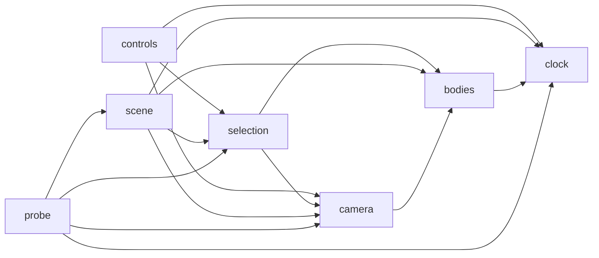

# Architecture Spine — solar-system

## Design Paradigm

One HTML file with inline CSS and one inline `<script>`. Inside the script, six modules as plain
object literals / closures, in this order: `bodies`, `clock`, `camera`, `scene`, `controls`,
`selection`, plus `probe` (test hooks). A `requestAnimationFrame` loop calls `clock.tick(dt)` then
`scene.draw()`. State lives in its owning module; everything else reads it.



## Invariants & Rules

### AD-1 — One file, no network [ADOPTED]
- **Binds:** NFR-4
- **Prevents:** a build step or CDN dependency that breaks opening from disk.
- **Rule:** the deliverable is `out/index.html` with all CSS/JS inline; no `fetch`, no external URLs.

### AD-2 — One writer per piece of state [ADOPTED]
- **Binds:** all
- **Prevents:** two modules moving time or the view, which makes tests and parallel stories drift.
- **Rule:** only `clock` writes time, paused and speed; only `camera` writes zoom and pan; only
  `selection` writes the selected body; `scene` only reads. `controls` calls the owners' methods.

### AD-3 — Two unit systems, one conversion
- **Binds:** NFR-3, FR-9..FR-13, FR-17, FR-18, FR-20
- **Prevents:** line widths or text that scale with zoom; ad-hoc conversions.
- **Rule:** positions/sizes in space units go through `camera.toScreen(p)` / `camera.toSpace(p)` only.
  Line widths, fonts, gaps and click reach are constants in px and never multiplied by zoom.
  Screen scale = base scale × zoom; base scale is recomputed on resize (width and height).

### AD-4 — Time advances by capped real time, or by test steps
- **Binds:** FR-4..FR-8
- **Prevents:** planets jumping after a hidden tab; flaky timing in tests.
- **Rule:** `clock.tick(realDt)` adds `min(realDt, 0.1) × speed × 365` days unless paused. The
  first probe `do` call freezes real time; after that only `probe.step(seconds)` advances, by exactly
  `seconds × speed` years, with no cap, not while paused.

### AD-5 — Test hooks on `window.__probe`
- **Binds:** NFR-7, every testable consequence
- **Prevents:** tests that reach into private state or depend on pixel colors.
- **Rule:** `window.__probe` exposes exactly these members (functions are called with the test's
  arguments; names are lowercase):
  - read: `time, paused, speed, zoom, pan, selected, bodies, body(name), startAngles, labels,
    strokes, layout, hud, panel, errors, comet, stars`
  - do: `step(seconds), slider(v), setPaused(on), click(x, y), clickBody(name), clickNear(name, px),
    zoomSteps(n), zoomAt(name, n), pinch(n), drag(dx, dy), press(key), use(control), resize(w, h),
    showComet()`
  - shapes: `body(name)` → `{x, y, r}`; `labels` → boxes; `strokes` → `{orbitLines, selectionRing,
    nameText}`; `layout` → `{gapTop, gapBottom, orbitTop, orbitBottom}`; `comet` → `{x, y}` or null;
    `stars` → `[{x, y}]`; `panel` → `{shown, text, fact}`; `hud` → time text;
    `clickNear(name, px)` clicks px further from the sun than the body's center; `pinch(n)` moves two
    touch points around the screen center apart by n zoom steps; `clickBody` dispatches a real
    pointer event; `use` takes `pause | reset | orbits | names`.
  - before each test: `resize(1280, 720) · use(reset) · slider(40) · setPaused(false)`.

### AD-6 — Draw order
- **Binds:** FR-14..FR-20
- **Prevents:** names hidden under bodies, ring under the planet.
- **Rule:** sky, stars, comet, orbits, sun, planets, moon, selection ring, names, time display.

### AD-7 — Canvas sized by devicePixelRatio
- **Binds:** NFR-5
- **Prevents:** blurry drawing on dense screens.
- **Rule:** backing store = CSS size × `devicePixelRatio`; the context is scaled so 1 px = 1 CSS px.

## Consistency Conventions

| Concern | Convention |
| --- | --- |
| Naming | body ids lowercase (`sun`, `mercury` … `moon`); controls `pause`, `reset`, `orbits`, `names` |
| Data & formats | time in days (float); angles in radians, clockwise; sizes/orbits in space units |
| State & cross-cutting | errors and warnings collected into `probe.errors` via `window.onerror` and a console wrapper |

## Stack

| Name | Version |
| --- | --- |
| HTML5 Canvas 2D, vanilla ES2022 | browser built-in |
| Node.js (test runner only) | 22 LTS |
| @playwright/test (Chromium, headless) | 1.48.2 |

`[GUESS: Playwright — the PRD only says "automated"; Chromium's built-in JS coverage via Playwright
gives the NFR-8 line-coverage number.]`

## Structural Seed

```text
out/
  index.html        # the whole app
tests/
  probe.spec.ts     # one test per PRD consequence, named FR-n / NFR-n
  helpers.ts        # opens file://…/out/index.html, runs the before-each reset
playwright.config.ts
```

## Capability → Architecture Map

| Capability / Area | Lives in | Governed by |
| --- | --- | --- |
| FR-1..FR-4 | `bodies` | AD-2, AD-4 |
| FR-5..FR-8 | `clock` | AD-2, AD-4 |
| FR-9..FR-13 | `camera` | AD-2, AD-3 |
| FR-14..FR-20 | `scene` | AD-3, AD-6, AD-7 |
| FR-21..FR-24 | `controls` | AD-2 |
| FR-25..FR-29 | `selection` | AD-2, AD-3 |
| NFR-2, NFR-7, NFR-8 | `probe`, `tests/` | AD-5 |

## Deferred

- Glow, shading, ring tilt, fonts, comet path shape — builder's choice per PRD §6; record in the
  story's Implementation Notes.
- Requirement-coverage measurement for SM-1 — no tool chosen; counted by hand from test names
  (or with the optional TEA module's `bmad-testarch-trace`). `[GUESS]`
