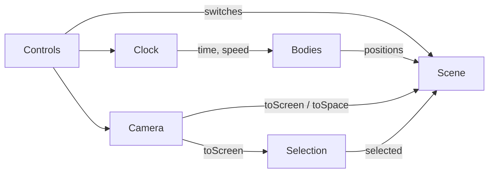

# Design Document

## Overview

One HTML file, `out/index.html`, with inline CSS and JavaScript and one 2D canvas. Six
components share one frame loop. The page runs offline, opened straight from disk.

## Architecture

Journey: on open, Bodies picks start angles (Req 3.1), the Clock starts (Req 4.1), and each
frame the Scene draws the body positions through the Camera's `toScreen`. Drag and zoom go to
the Camera, clicks to Selection, the slider, pause and reset to Controls.

### State ownership (one writer per piece of state)

| State | Owner | Everyone else |
|---|---|---|
| time, paused, speed | Clock | reads |
| zoom, pan | Camera | reads |
| selected | Selection | reads |
| orbits / names switches | Controls | reads |

Rationale: one owner per piece of state lets agents work on components in parallel. Reset
(Req 18.6) calls `Clock.reset()`, `Camera.reset()` and `Selection.clear()` instead of writing
their state itself.

## Components and Interfaces

### Bodies
- `table`: name, size, orbit, orbit time (days), color, fun fact for all 10 bodies
  (Req 1, Req 2).
- `positionAt(name, days)`: angle = start + 2π x (days / orbitDays), clockwise; the moon is
  offset from Earth's current position (Req 3.3).

### Clock
- Each frame adds `min(realSeconds, 0.1) x speed x 365` days (Req 4.2, 4.7).
- `speed = (slider / 100)^2` years per second.

### Camera
- Base scale fits the outermost orbit (Neptune, 420) plus 28 px between the 56 px bars, capped
  at 1 px per space unit; zoom multiplies it. Recomputed on resize, width and height
  (Req 5.2, 5.3).
- `zoomAt(screenPoint, steps)`: zoom x 1.1^steps, clamped to [0.3, 6], pan adjusted so the
  point under the pointer stays put (Req 6).
- Pointer down/up: movement under 4 px is a click (Req 7.2).
- `toScreen(p)`, `toSpace(p)`.

### Scene
- Draw order: sky, stars, comet, orbits, sun, planets, moon, selected ring, names, time.
- Look (glow, shading, ring tilt, fonts) is left to the implementer; see "Open choices".

### Controls
- One small bar at the left of the bottom bar: slider, Pause/Play button, Orbits, Names, Reset.
- Space is handled on `window` with `preventDefault`, so a focused control does not swallow it
  (Req 18.4; see the bugfix spec `pause-space-after-click`).

### Selection
- Hit test: every body whose on-screen radius, or 10 px if larger, contains the click; the
  nearest center wins, not a fixed order. Rationale: at the start zoom the moon's click area
  covers Earth; a fixed order made Earth unclickable (Req 16.2).

## Test hooks (window.__probe)

Members of `window.__probe`; a member that is a function is called with the test's arguments.
The first action freezes real time; after that only `step(seconds)` moves the clock, by exactly
seconds x speed, no cap, not while paused (Req 20.2).

- Read: `time, paused, speed, zoom, pan, selected, bodies, body(name), startAngles, labels,
  strokes, layout, hud, panel, errors, comet, stars`
- Do: `step(seconds), slider(v), setPaused(on), click(x, y), clickBody(name),
  clickNear(name, px), zoomSteps(n), zoomAt(name, n), pinch(n), drag(dx, dy), press(key),
  use(control), resize(w, h), showComet()`
- Before each test: `resize(1280, 720)`, `use("reset")`, `slider(40)`, `setPaused(false)`.

Meanings: names are lowercase; `body(name)` is `{x, y, r}`; `labels` is a list of boxes;
`strokes` is `{orbitLines, selectionRing, nameText}`; `layout` is `{gapTop, gapBottom}`
(between the nearest orbit, body or name and the edges) and `{orbitTop, orbitBottom}` (between
the outermost orbit and the edges); `comet` is `{x, y}` of its head or null; `stars` is the
`{x, y}` of every star; `panel` is `{shown, text, fact}`; `hud` is the time text;
`clickNear(name, px)` clicks px further from the sun than the body's center; `pinch(n)` moves
two touch points around the screen center apart by n zoom steps (negative: together);
`clickBody` sends a real click; `use` takes pause, reset, orbits or names.

## Data Models

`Body = { name, size, orbit, days, color, fact, parent? }` (the moon's parent is Earth).
`ClockState = { days, paused, slider }`. `View = { zoom, panX, panY, baseScale }`.

## Error Handling

- `errors` collects `window.onerror`, unhandled rejections and `console.error/warn`
  (Req 19.5).
- A long gap between frames counts as 0.1 s (Req 4.7).

## Correctness Properties

Each property is a statement for any input that a test checks. "Validates" names the
acceptance criteria. (Guess: Kiro writes these itself during the design phase; they are
written out here so that every FACT test has a home.)

Property 1: Start angles are stable. For any number of steps, `startAngles` is unchanged.
**Validates: Requirements 3.1, 3.2**

Property 2: Zoom stays in range. For any sequence of zoom steps, 0.3 <= zoom <= 6.
**Validates: Requirements 6.3**

Property 3: Zoom keeps the anchor. For any body and one zoom step at it, the body's screen x
changes by at most 1 px. **Validates: Requirements 6.1, 6.2**

Property 4: px lengths ignore zoom. For any zoom steps, `strokes` is unchanged and
`body(earth).r` changes. **Validates: Requirements 8.1, 8.2, 12.1**

Property 5: Stars ignore the view. For any zoom and drag, `stars` is unchanged and there are
300. **Validates: Requirements 9.2**

Property 6: Every body is clickable. For any body name, `clickBody(name)` selects it and the
panel's fact is 1 sentence. **Validates: Requirements 1.1, 2.2, 16.1**

Property 7: Names never overlap. For any time at top speed, `overlaps(labels) = 0`.
**Validates: Requirements 13.2**

## Testing Strategy

Automated tests run in headless Chrome against `out/index.html` through the Probe. Coverage
targets: 90% of acceptance criteria validated by a test, 80% of lines exercised (Req 20.3,
20.4). The example tests below are the fixed cases; the properties above are also run with
random inputs.

| Test | Steps | Expect | Validates |
|---|---|---|---|
| learn | clickBody(mars) | panel.shown is true | 17.1 |
| no-errors | step(5) | count(errors) = 0 | 19.5 |
| units | remember strokes, body(earth); zoomSteps(5) | strokes unchanged; earth.r changed by > 0 | 8.1, 8.2 |
| viewer | (none) | body(sun).r > 0; count(errors) = 0 | 19.1 |
| planets | (none) | count(bodies) = 10 | 1.1 |
| start-places | remember startAngles; step(5) | unchanged | 3.2 |
| positions | slider(100); remember earth; step(1) | earth.x changed by 0 ± 1 | 3.4 |
| sun | (none) | sun.r > jupiter.r | 1.6 |
| moon | slider(100); remember offset(moon, earth); step(0.073972602739726) | offset x and y changed by 0 ± 0.5 | 3.5 |
| fun-facts | each body: clickBody(name) | sentences(panel.fact) = 1 | 2.1, 2.2 |
| table | each body: clickBody(name) | selected is name | 1.1, 16.1 |
| fit | each size 1280x720, 800x600, 640x480 | gapTop >= 56; gapBottom >= 56; orbitTop = 84 ± 0.5; orbitBottom = 84 ± 0.5 | 5.2, 5.4 |
| zoom-step | remember earth; zoomAt(earth, 1) | zoom = 1.1; earth.x changed by 0 ± 1 | 6.1, 6.2 |
| zoom-step (pinch) | zoomAt(earth, -1); pinch(1) | zoom = 1.1 | 6.1 |
| limits | zoomSteps(200), then zoomSteps(-400) | zoom = 6, then 0.3 | 6.3 |
| drag | drag(50, 0); then drag(3, 0) | pan.x changed by 50 ± 0.5; then pan unchanged | 7.1, 7.2 |
| to-screen | remember mars; drag(30, 0) | mars.x changed by 30 ± 0.5 | 7.3 |
| speed | slider(0) step(1); slider(50) step(4); slider(100) step(1) | unchanged; +365 ± 1%; +365 ± 1% | 4.2, 4.3, 4.4 |
| pause | press(Space); step(2) | time unchanged | 4.5 |
| clock start | (after reset) | time = 0; paused is false | 4.1 |
| time | slider(100); step(1) | time = 365 | 4.6 |
| checkboxes | use(orbits); use(names); step(0) | strokes.orbitLines is null; count(labels) = 0 | 10.2, 13.4 |
| pause after click | use(pause); press(Space) | paused is false | 18.3, 18.4 |
| reset | zoomSteps(4); drag(50, 50); slider(70); remember speed; use(reset) | zoom = 1; speed unchanged | 18.6 |
| slider | slider(50) | speed = 0.25 ± 0.001 | 18.2 |
| switches | use(orbits); use(orbits) | orbitLines null; then = 1 | 10.1, 10.2 |
| sky | remember stars; zoomSteps(5); drag(30, 0) | count(stars) = 300; stars unchanged | 9.2 |
| names | 20 rounds: slider(100); step(1) | overlaps(labels) = 0 | 13.2 |
| selected | clickBody(jupiter); zoomAt(jupiter, -400); remember strokes; zoomAt(jupiter, 400) | strokes unchanged | 8.2, 12.1 |
| hud | slider(100); step(1) | hud contains "Year 1" | 14.1 |
| comet | showComet(); remember comet; drag(50, 0) | comet.x changed by 50 ± 1 | 15.2 |
| panel | clickBody(jupiter) | text contains "Jupiter" and "years" | 17.1, 17.2 |
| nearest | each size 1280x720, 800x600; 10 rounds: zoomSteps(-400); step(0.37); click mercury, earth, moon | each selected | 16.2, 16.4 |
| miss | clickBody(jupiter); click(3, 300) | selected is null | 16.3 |
| reach | zoomSteps(-400); clickNear(neptune, 9); clickNear(neptune, 12) | "neptune"; then null | 16.1 |
| selected (click) | clickBody(venus) | selected is "venus" | 16.1 |
| input | zoomSteps(1) | zoom = 1.1 | 19.4 |
| probes | slider(100); remember time; step(1) | time changed by 365 ± 0 | 20.2 |
| meanings | (none) | earth.r > 0; gapTop > 0; count(labels) > 0; panel.shown is false | 20.1, 17.4 |

Manual checks (a person ticks these; the agent must not):
- Real-time cap after a long gap (Req 4.7): needs a real clock; the Probe freezes time.
- Glow, sun-side shading and Saturn's ring crossing (Req 11): judged by eye. Earlier build drew
  flat circles.
- Offline from disk with networking off (Req 19.2).
- Sharp on a dense screen (Req 19.3).

Known regressions to keep covered: the first build drew no stars (sky test); Space after a click
did not toggle pause (bugfix spec `pause-space-after-click`).

## Open choices (notes)

Glow, shading, ring tilt, fonts, star twinkle rate, comet path and tail length, the fun-fact
wording, and the exact panel layout are the implementer's choice. Record what was chosen in the
comment at the top of `out/index.html`.
